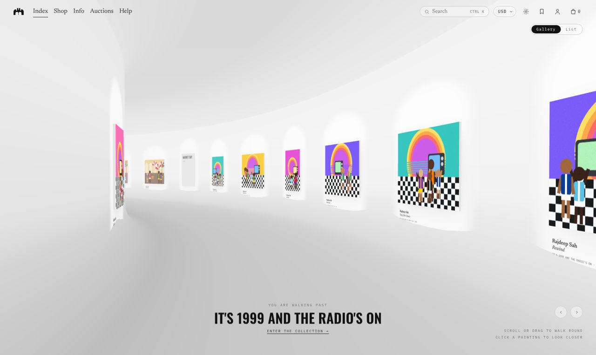
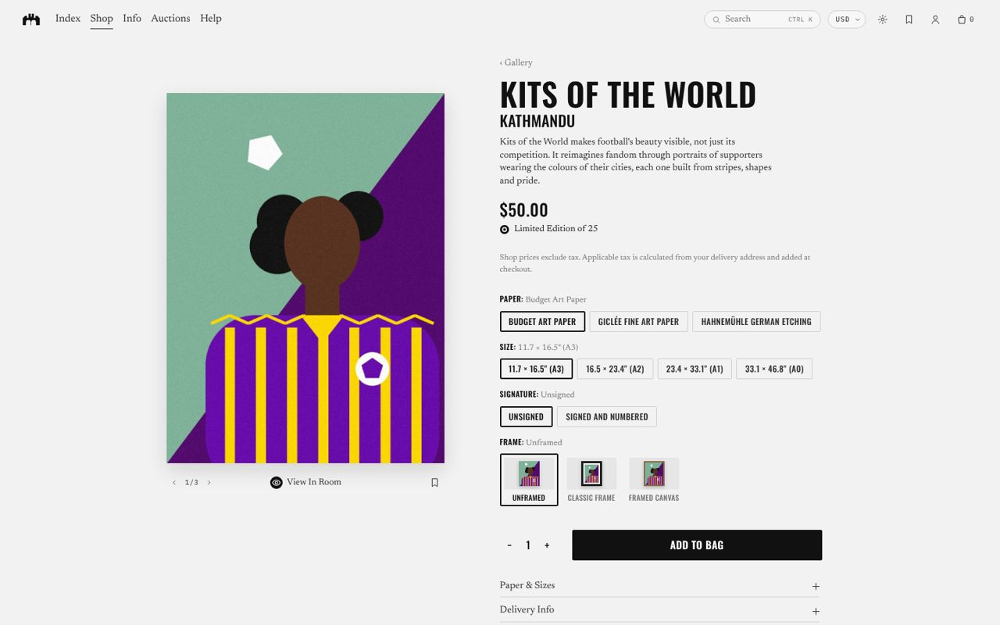
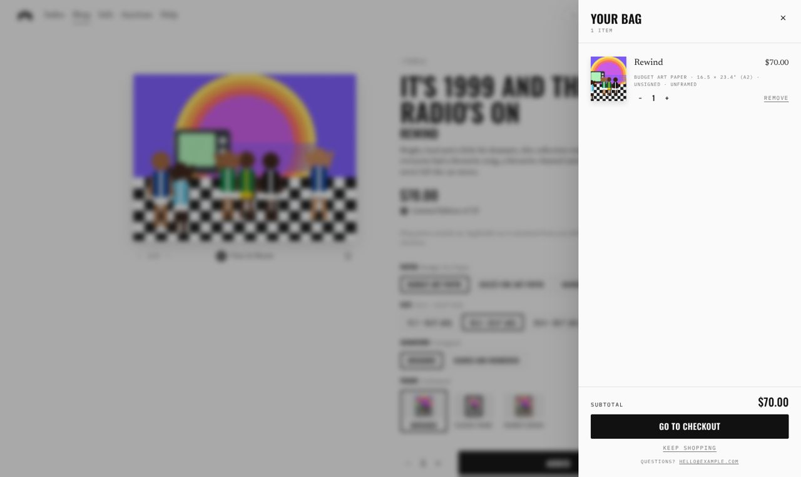
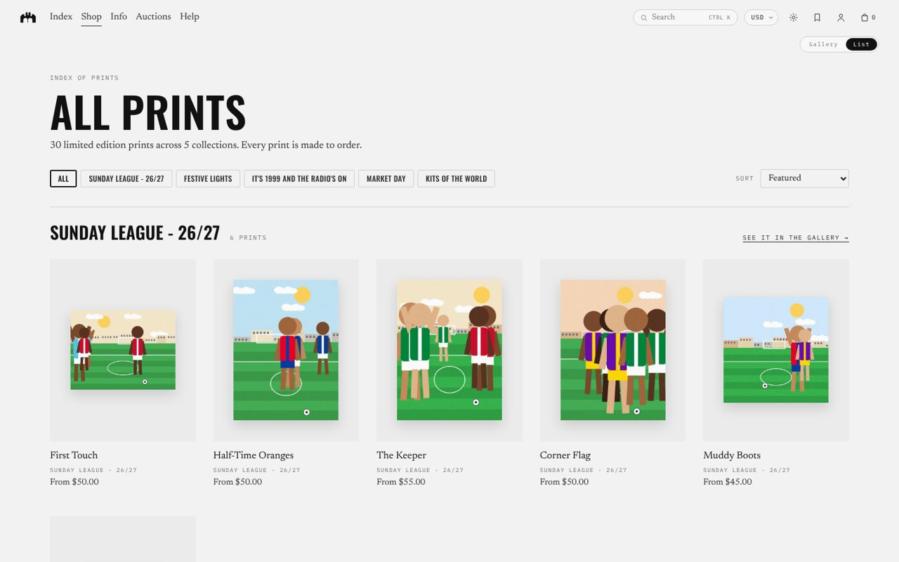
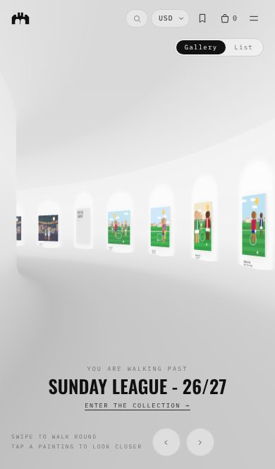

# Artsite: 3D gallery print shop

An online art print shop whose home page is a **walk-through 3D gallery**. Visitors walk round a
curved white corridor, click a painting to look closer, and buy limited edition prints.

Built by **Rajdeep Sah**.



> All artwork in `assets/artworks/` is **placeholder art**. Replace it with your own; it only
> takes a minute (see [docs/CUSTOMIZE.md](docs/CUSTOMIZE.md)).

## Features

- **3D gallery** (Three.js): a ring-shaped corridor with prints on both walls, a grey title card
  per collection, soft arched niches, wall labels and fog. Scroll, drag, swipe or use the arrow keys
  to walk. The corridor loops forever.
- **"You are walking past"** HUD that follows the collection you are in, with prev/next buttons.
- **Click a painting**: the camera flies up to it, the gallery fades to white and the print slides
  into the product page.
- **Product page**: paper, size, signature and frame options with a live price, quantity, add to
  bag, three image views including **View in room**, save to list, accordions and "Get the collection".
- **Bag drawer** with a blurred backdrop, a **saved prints** list, and a **checkout** with validation
  and order confirmation (demo only, no payments yet).
- **List / Shop view** with collection filters and sorting, plus **Cmd/Ctrl+K search**.
- **Info**, **Auctions** (live countdowns and bidding) and **Help** (FAQ and contact form) pages.
- **Currencies**: USD, GBP, EUR and INR. The bag, saved prints and settings are kept in the browser.
- **Mobile friendly** with touch controls, **keyboard accessible**, a reduced-motion setting, and an
  automatic fallback to the list view when WebGL is not available.

| Product page | Bag | List | Mobile |
| --- | --- | --- | --- |
|  |  |  |  |

## Run it locally

There is no build step, so any static file server works. Opening `index.html` directly
(`file://`) will **not** work, because ES modules need a server.

```bash
npm start                    # = node tests/serve.cjs 8080 (no install needed)
# or
python3 -m http.server 8080
```

Then open <http://localhost:8080>.

## Tests

```bash
npm install                  # installs Playwright (first time only)
npx playwright install chromium
npm test                     # 18 browser tests: gallery, transitions, product, bag, checkout...
```

## Deploy

All paths are relative, so the site works from any static host or sub-folder:

- **GitHub Pages**: repo Settings → Pages → "Deploy from a branch" → pick the branch and `/ (root)`.
- **Netlify / Vercel / Cloudflare Pages**: no build command; the publish directory is the repo root.

## Project structure

```
index.html            page shell (header, gallery canvas, HUD)
css/                  styles by area: base, header, gallery, product, overlays, pages
js/main.js            entry point: routes, views and the gallery <-> page transitions
js/gallery/           3D gallery (scene.js) and canvas-drawn textures (textures.js)
js/ui/                product page, bag, saved, search, list, pages, checkout, header, HUD...
js/store.js           bag / saved / currency / settings / orders (localStorage)
js/pricing.js         print options, price rules, exchange rates
js/router.js          hash router (#/print/<slug>, #/list, ...)
data/catalog.json     ALL content: site info, collections, prints
assets/artworks/      print images (placeholders)
assets/fonts/         self-hosted fonts (Oswald, Newsreader, IBM Plex Mono)
vendor/               three.js (kept in the repo, no CDN needed)
tools/                generate-placeholders.py
tests/                serve.cjs (static server), e2e.cjs (browser tests)
docs/                 plan, progress, customisation guide, screenshots
```

## Documentation

- [docs/CUSTOMIZE.md](docs/CUSTOMIZE.md): add your artwork, prices and text
- [docs/PROGRESS.md](docs/PROGRESS.md): what is done, what could come next, how to continue
- [docs/PLAN.md](docs/PLAN.md): what the reference video shows, the phased plan and design notes

## Before going live

- Replace the placeholder artwork and the example email (`hello@example.com`) in `data/catalog.json`.
- Connect real payments (for example Stripe Checkout or Shopify Buy Button). Checkout is currently a
  front-end demo; see the note at the top of `js/ui/checkout.js`.
- Optionally connect the contact form and auction bids to a backend (they currently work in the
  browser only).
